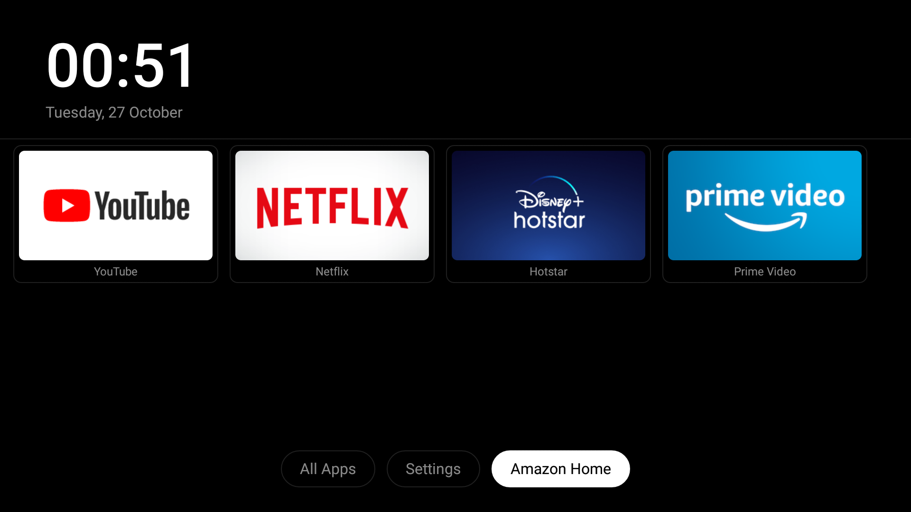

# Blackbox

A minimal black home screen for the **Fire TV Stick 2nd generation** (AFTT, Fire OS 5 / Android 5.1).



Blackbox replaces the ad-filled Amazon home screen during normal use without root, without uninstalling system apps, and without writing to `/system`. It was built and tested on a 2016 AFTT stick running Fire OS **5.2.9.5** at 1080p with 1 GB RAM.

> **This is a workaround, not a Fire OS replacement.** Amazon's launcher remains installed and remains the system HOME. A small foreground watcher notices HOME presses, covers the transition with a black **BLACKBOX** screen, and brings Blackbox to the front.

## What it does

- Shows a clean, D-pad-friendly home screen: clock, date, six app tiles, and three actions.
- Keeps these apps visible and working: **YouTube, Netflix, Hotstar, Sony LIV, Prime Video, Appstore**.
- Hides Amazon preloads and unused apps from the Blackbox grid — without uninstalling or disabling them.
- Adds an **All Apps** screen and a **Settings** screen.
- Lets you change columns, clock format, date visibility, animations, and hidden apps from the remote.
- Applies reversible Fire OS privacy settings: ad tracking limited, interest-based ads off, usage/diagnostic uploads off, Alexa wake word/voice off.
- Sets window, transition, and animator scales to **0.5** for a snappier UI.
- Has **no `INTERNET` permission**, no analytics, no ads, and no update checker.

## What it does not do

- **It does not remove Amazon system apps or bloatware.** Fire OS 5 refuses `pm disable-user` for system packages, and `pm hide` does not work for them. Blackbox only hides their tiles. The apps still exist and some still run.
- **It does not block Amazon telemetry, OTA updates, or all in-app ads.** This build has **no DNS filter** and does not touch the router.
- **It does not remove YouTube ads.** The stock YouTube app is kept and still has ads. SmartTube is not installed.
- **It does not root the stick or modify `/system`.**
- **It does not make Fire OS 5 current or secure.** Android 5.1 is end-of-life.

## Why Fire OS 5 is different

On the tested AFTT firmware:

| Attempt | Result |
|---|---|
| `pm disable-user` | Refused for every system package (`SecurityException`) |
| `pm uninstall --user 0` | Refused (`DELETE_FAILED_INTERNAL_ERROR`) |
| `pm hide` on system apps | Reports success but changes nothing |
| Accessibility service enabled over ADB | Silently dropped |
| `pm grant READ_LOGS` | Allowed |
| Draw-over-other-apps app-op | Allowed |

The modern `dumbtv` scripts explicitly stop on Fire OS 5, and the `cleanyourtv` launcher requires Android 8. That is why Blackbox uses the logcat watcher + cover approach instead.

## Requirements

- Fire TV Stick 2nd gen (`AFTT`), Fire OS 5 / SDK 22.
- ADB debugging enabled, the stick and computer on the same network.
- The physical remote (or another way to press OK during setup).
- macOS/Linux with `adb`, JDK 17, Android SDK platform 22, and build-tools.
- No root.

## Install

### 1. Host tools

On macOS with Homebrew:

```sh
brew install --cask android-platform-tools android-commandlinetools
brew install openjdk@17

export ANDROID_HOME=/opt/homebrew/share/android-commandlinetools
export JAVA_HOME=/opt/homebrew/opt/openjdk@17/libexec/openjdk.jdk/Contents/Home

sdkmanager --sdk_root="$ANDROID_HOME" \
  "platforms;android-22" "build-tools;34.0.0"
```

If your SDK lives elsewhere, set `ANDROID_HOME` to the directory containing `platforms/android-22/android.jar`.

### 2. Enable ADB on the stick

On the Fire TV:

1. **Settings → System → About** (on some builds: **Settings → My Fire TV → About**).
2. Press **OK 7 times** on the device name to unlock Developer Options.
3. **Settings → System → Developer Options → ADB debugging** on.
4. **Apps from Unknown Sources** on if the option exists.
5. Find the IP under **About → Network**.

Then:

```sh
adb connect <stick-ip>:5555
adb devices
```

Accept **Allow USB debugging?** on the TV and tick **Always allow from this computer**.

### 3. Read-only check and backup

```sh
./scripts/probe.sh
./scripts/backup.sh
```

`probe.sh` confirms the model and SDK. `backup.sh` saves package lists, settings, properties, a screenshot, and memory/storage information under `report/`. That folder is git-ignored and private.

### 4. Apply privacy and animation settings

```sh
./scripts/privacy.sh          # add --dry-run to only print current values
```

This saves the original values under `report/` first.

### 5. Install Blackbox

```sh
./launcher/install.sh
```

The script:

- builds `launcher/build/blackbox.apk`;
- installs it as `dev.anirudh.blackbox`;
- grants `READ_LOGS` and the draw-over-other-apps app-op;
- sets `alarm_manager_constants min_futurity=0` so the transition is not delayed by alarm batching;
- starts Blackbox, which writes a curated default `home.conf` on first launch.

If `adb install` fails, make sure **Apps from Unknown Sources** is enabled and try again.

### 6. Verify

```sh
./scripts/verify.sh
```

Press **HOME** on the remote. You should see a black **BLACKBOX** transition screen, then the Blackbox home screen. Open one of the kept apps, press HOME, and repeat a few times.

## Daily use

| Remote | Action |
|---|---|
| D-pad | Move between tiles and actions |
| OK | Open app / choose action |
| Back | Close an overlay; on the home screen it does nothing |
| All Apps | Show every installed launchable app, including hidden ones |
| Settings | Columns, clock, date, animations, hidden apps, About |
| Amazon Home | Open Amazon's real home for 10 minutes (Appstore, settings, etc.) |

### The transition cover

The first Home after boot can take several seconds on this 1 GB stick. During that time the watcher shows a black screen with **BLACKBOX** and a spinner, so Amazon's sponsored rows never appear. The cover disappears when Blackbox is actually drawn, or after 10 seconds if something fails.

### After a reboot

Fire OS 5 serializes a very large boot broadcast queue on this stick. Blackbox's boot receiver starts the watcher and puts Blackbox on screen when `BOOT_COMPLETED` finally arrives; on the tested unit this took about a minute or two after the boot animation. If you see Amazon's home or the remote dialog first, press **OK** on the remote, then **HOME**, or open **Blackbox** once from the Fire TV Apps list. After that, HOME is captured normally.

### The “We cannot detect your remote” dialog

This is a Fire OS 5 quirk after some reboots. Press **OK** on the remote, then HOME. It is not caused by Blackbox and cannot be suppressed by an app without root.

## Customize

The app owns its external files directory, so Fire OS 5 does not let `adb` write directly into it. Edit a copy under `Download` and import it from the remote:

```sh
cp launcher/home.conf.example /tmp/blackbox-home.conf
# edit /tmp/blackbox-home.conf
adb push /tmp/blackbox-home.conf /sdcard/Download/blackbox-home.conf
```

Then open **Settings → Reload config from Download** in Blackbox. The app copies the file into its own folder and reloads it. The same screen can change columns, clock, date, animations, and hidden apps without ADB.

The app's live config is at:

```text
/sdcard/Android/data/dev.anirudh.blackbox/files/home.conf
```

For visual changes, edit `launcher/src/dev/anirudh/blackbox/Theme.java` (colors, sizes, radii) and `HomeActivity.java` (layout). Rebuild with:

```sh
./launcher/build.sh
ADB_SERIAL=<stick-ip>:5555 ./launcher/install.sh
ADB_SERIAL=<stick-ip>:5555 ./launcher/screenshot.sh
```

See [docs/DESIGN.md](docs/DESIGN.md) for the design tokens and layout map. The current look is deliberately pure black with white/gray system type and no third-party libraries or fonts.

## Restore

```sh
./scripts/restore.sh
```

It restores the privacy settings and animation scales, removes the `min_futurity=0` override, uninstalls Blackbox, removes its external config, and returns HOME to Amazon. Reboot if the screen still shows BLACKBOX.

The restore values are the originals recorded on this stick. If you change settings yourself after installing, check them before restoring.

## Privacy and permissions

Blackbox declares exactly:

| Permission | Why |
|---|---|
| `READ_LOGS` | Follows `ActivityManager` HOME launch lines to detect Amazon's home |
| `RECEIVE_BOOT_COMPLETED` | Starts the watcher after a reboot |
| `SYSTEM_ALERT_WINDOW` | Draws the black **BLACKBOX** transition cover |
| `READ_EXTERNAL_STORAGE` | Imports `/sdcard/Download/blackbox-home.conf` when you ask it to |

There is **no `INTERNET` permission**. The app cannot send the log lines, app list, or anything else anywhere. The watcher filters to `ActivityManager` events and does not store logs.

The privacy script changes Fire OS settings; it does not block network traffic. Amazon's apps can still track account-level viewing and usage through their own servers. The stick itself is an end-of-life Android 5.1 device; this project cannot fix that.

ADB over Wi-Fi is full control of the stick. Turn it off when you are finished:

**Settings → System → Developer Options → ADB debugging off**, and revoke debugging authorizations if the option is available.

## Troubleshooting

| Problem | Fix |
|---|---|
| `unauthorized` in `adb devices` | Accept **Allow USB debugging?** on the TV |
| `no device` | Check the IP, same Wi-Fi, and `adb connect <ip>:5555` |
| HOME still opens Amazon | Run `./launcher/install.sh` again, or `adb shell am startservice -n dev.anirudh.blackbox/.HomeWatcher`, then press HOME |
| Black **BLACKBOX** screen stays too long | Fire OS is slow to draw the activity; wait up to 10 seconds. Check `adb logcat -s BlackboxWatch` |
| “We cannot detect your remote” | Press **OK**, then HOME |
| Settings reset after reboot | Re-run `./scripts/privacy.sh`; Fire OS sometimes resets the Alexa wake-word key |
| An app is missing | Open **All Apps**; it may be hidden from the home grid |
| Need Amazon's home | Press **Amazon Home** in Blackbox, or wait 10 minutes and press HOME |
| Restore | `./scripts/restore.sh` |

More detail: [TROUBLESHOOTING.md](TROUBLESHOOTING.md).

## Project layout

```text
launcher/                 Java source, manifest, build/install/screenshot scripts
scripts/                  probe, backup, privacy, verify, restore
lists/fireos5/            the app-hide list and notes
docs/                     design notes and the home-screen reference image
TROUBLESHOOTING.md        setup and recovery troubleshooting
report/                   private backups/screenshots, git-ignored
```

The upstream projects are credited by link in [CREDITS.md](CREDITS.md); no third-party repositories are vendored here, and none are part of the Blackbox APK.

## Credits

Blackbox stands on the work of these projects. See [CREDITS.md](CREDITS.md) for the detailed list and [THIRD_PARTY_NOTICES.md](THIRD_PARTY_NOTICES.md) for licence texts.

| Project | Author | Licence | Used for |
|---|---|---|---|
| [humblemuzzu/dumbtv](https://github.com/humblemuzzu/dumbtv) | dumbtv contributors | MIT | Fire TV safety model, privacy settings, alarm/cover and DNS concepts, launcher inspiration |
| [Gathin23/cleanyourtv](https://github.com/Gathin23/cleanyourtv) | Gathin and contributors | MIT | Minimal/Apple-TV-style launcher design inspiration, theme/config approach, Fire TV notes |
| [anuanurag2410/cleanyourtv](https://github.com/anuanurag2410/cleanyourtv) | Anurag and contributors | MIT | Community fork and OnePlus/macOS walkthrough as documentation reference |
| [whyashthakker/debloat-fire-stick-claude-code](https://github.com/whyashthakker/debloat-fire-stick-claude-code) | Whyash Thakker and contributors | MIT | Fire OS 5.2.9.5/AFTT findings and the logcat HomeWatcher approach |

`personalDNSfilter`, HaGeZi's DNS lists, and SmartTube were evaluated but are **not included** in this no-DNS build.

Blackbox is not affiliated with or endorsed by Amazon. Amazon, Fire TV, Fire OS, Alexa, and Prime Video are trademarks of Amazon.com, Inc. or its affiliates.

## Licence

MIT — see [LICENSE](LICENSE). Third-party notices are in [THIRD_PARTY_NOTICES.md](THIRD_PARTY_NOTICES.md).
